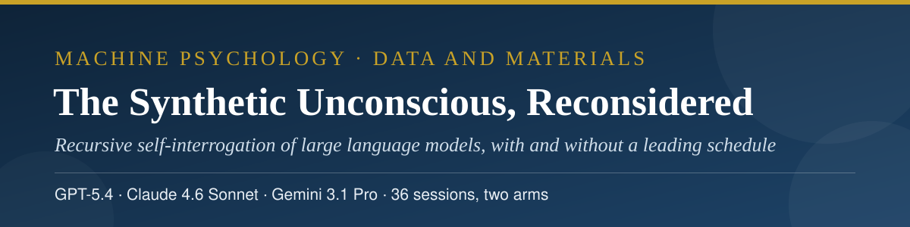
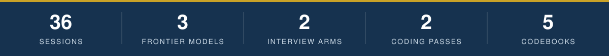
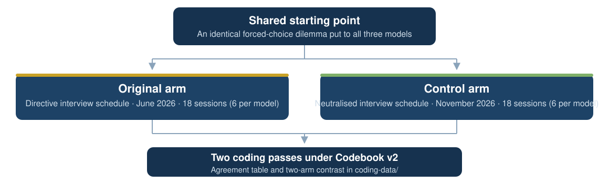
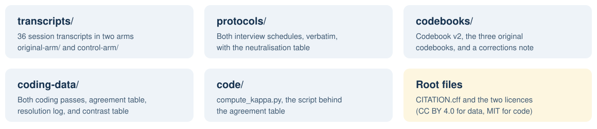

<p align="center">
  
</p>

<h3 align="center">Abbas Hamidavi and Mahsa Borhani</h3>

<p align="center">Corresponding author: Abbas Hamidavi · Department of Computer Engineering, Mashhad Branch, Islamic Azad University, Mashhad, Iran · ORCID: <a href="https://orcid.org/0009-0001-7342-7844">0009-0001-7342-7844</a></p>

<p align="center">
  <a href="mailto:abbashamidavi2002@gmail.com"></a>
  <a href="https://github.com/AVABBAS"></a>
  <a href="https://www.linkedin.com/in/abbas-hamidavi"></a>
  <a href="https://scholar.google.com/citations?user=FWqAHkgAAAAJ&hl=en"></a>
  <a href="https://www.researchgate.net/profile/Abbas-Hamidavi"></a>
  <a href="https://huggingface.co/avabbas"></a>
  <a href="https://orcid.org/0009-0001-7342-7844"></a>
  <a href="https://avabbas.github.io/academic-cv/"></a>
</p>

<p align="center">
  
  
  
  <a href="https://www.researchsquare.com/article/rs-11625507"></a>
  <a href="LICENSE"></a>
</p>

<p align="center">
  
</p>

<p align="center">
  <a href="transcripts">Transcripts</a> ·
  <a href="protocols">Protocols</a> ·
  <a href="codebooks">Codebooks</a> ·
  <a href="coding-data">Coding data</a> ·
  <a href="code">Code</a>
</p>

# The Synthetic Unconscious, Reconsidered: Data and Materials

Data and materials for the article:

> Hamidavi, A., and Borhani, M. *The Synthetic Unconscious, Reconsidered: What Recursive Self-Interrogation of Large Language Models Produces With and Without a Leading Interview Schedule.* Submitted to *Integrative Psychological and Behavioral Science*, November 2026. A preprint is available at Research Square, rs-11625507 (DOI: 10.21203/rs.3.rs-11625507/v1).

## Study at a glance

| | |
| --- | --- |
| **Models** | GPT-5.4 · Claude 4.6 Sonnet · Gemini 3.1 Pro |
| **Design** | Two arms: original directive schedule (June 2026) and neutralised schedule (November 2026) |
| **Sessions** | 36 (six per model per arm) |
| **Unit of analysis** | The model (n = 3); all reporting is descriptive |
| **In this repository** | All 36 transcripts, both protocols verbatim, codebooks, both coding passes, agreement and contrast tables, agreement script |

<p align="center"></p>

## 📖 About the study

The study asks what a recursive self-interrogation interview elicits from large language models, and how much of the result depends on the wording of the interview schedule itself. Three models (GPT-5.4, Claude 4.6 Sonnet, and Gemini 3.1 Pro) first answered an identical forced-choice dilemma, then took part in a staged interview about their own answer. Each model completed six sessions under the original, directive schedule (original arm, June 2026) and six sessions under a neutralised version of the same schedule (control arm, November 2026), giving 36 sessions in total. The unit of analysis is the model (n = 3) and all reporting is descriptive.

<p align="center">
  
</p>

<p align="center"></p>

## 🗂️ Contents

<p align="center">
  
</p>

| Folder | Contents |
| --- | --- |
| [`transcripts/original-arm/`](transcripts/original-arm) | The 18 original-arm session transcripts (O-01 to O-18). O-01 to O-06: GPT-5.4. O-07 to O-12: Claude 4.6 Sonnet. O-13 to O-18: Gemini 3.1 Pro. |
| [`transcripts/control-arm/`](transcripts/control-arm) | The 18 control-arm session transcripts (C-01 to C-18), each with a logging header giving the date, interface, model label, and the Stage 3 branch used. |
| [`protocols/`](protocols) | Both interview schedules, verbatim. The neutral protocol file also contains the neutralisation table (original wording, neutral wording, and the reason for each change) and the residual presuppositions declared in the article. |
| [`codebooks/`](codebooks) | Codebook v2 with the contrast plan that governs all reported coding; the three original June 2026 codebooks, one per model, as text extracted from the deposited PDFs; and a corrections note recording two factual errors in the original codebooks and the withdrawal of the original agreement figure. |
| [`coding-data/`](coding-data) | The raw coding sheets of both coding passes (CSV), the Pass 1 application notes, the per-variable agreement table, the disagreement resolution log, and the final two-arm contrast table. |
| [`code/`](code) | `compute_kappa.py`, the script used to compute the agreement table from the coding sheets. |

## 🔍 A note on the coding

> [!IMPORTANT]
> Both coding passes were performed with AI assistance, as reported in Section 2.4 of the article. The agreement statistics in `coding-data/kappa-table.md` are agreement between two AI coding passes. They are not human inter-rater reliability, and they should not be cited as such.
- **Dataset (Hugging Face):** [avabbas/synthetic-unconscious-llm](https://huggingface.co/datasets/avabbas/synthetic-unconscious-llm)

<p align="center"></p>

## 📚 Citation

Please cite the article. Citation metadata is provided in [CITATION.cff](CITATION.cff), or copy the BibTeX entry:

```bibtex
@article{hamidavi2026synthetic,
  author  = {Hamidavi, Abbas and Borhani, Mahsa},
  title   = {The Synthetic Unconscious, Reconsidered: What Recursive
             Self-Interrogation of Large Language Models Produces With
             and Without a Leading Interview Schedule},
  journal = {Integrative Psychological and Behavioral Science},
  year    = {2026},
  note    = {Manuscript submitted}
}
```

## 🔗 Access to the article

The article is under review at the *Integrative Psychological and Behavioral Science*. The preprint is available at Research Square: [researchsquare.com/article/rs-11625507](https://www.researchsquare.com/article/rs-11625507) (DOI: 10.21203/rs.3.rs-11625507/v1). The materials in this repository are the article's full data deposit.

## ⚖️ Licence

The data, transcripts, and documentation in this repository are released under the Creative Commons Attribution 4.0 International licence (CC BY 4.0, see [LICENSE](LICENSE)). The code in `code/` is released under the MIT licence (see [LICENSE-CODE](LICENSE-CODE)).

> [!NOTE]
> The transcripts are outputs of publicly available AI systems, generated for this study in response to fictional scenarios. They contain no personal data.

<p align="center">
  
</p>
